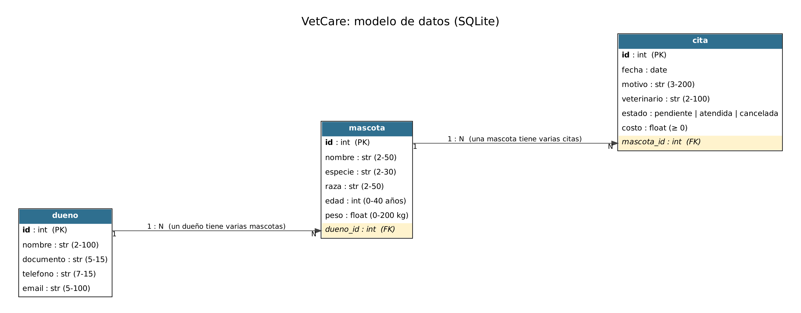
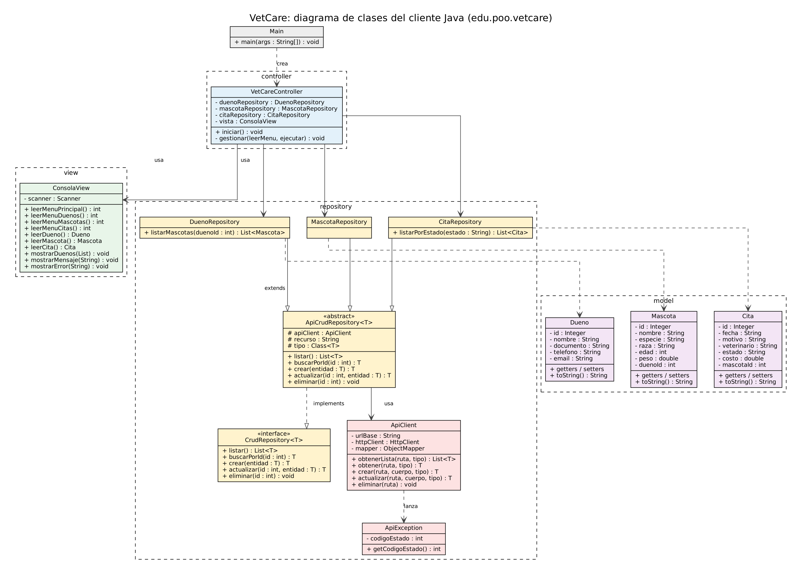

# VetCare

API REST para gestionar una clínica veterinaria (dueños, mascotas y citas) y cliente Java de consola que la consume.
Proyecto del Taller Final de Programación Orientada a Objetos.

**Autor:** Sneyder Yessid Rondon Infante

## Qué hace

- **API** (`api/`): FastAPI + SQLModel + SQLite. Ofrece el CRUD completo de tres recursos relacionados y dos consultas adicionales.
- **Cliente** (`cliente/`): aplicación de consola en Java 17 con patrón MVC. Consume la API con `HttpClient` y convierte el JSON con Jackson.

## Modelo de datos

Un dueño tiene varias mascotas y una mascota tiene varias citas.



## Requisitos

| Herramienta | Versión |
| --- | --- |
| Python | 3.11 o superior |
| JDK | 17 o superior |
| Maven | 3.9 o superior |
| Git | Versión actual |

## Instalación y ejecución

### 1. API

Desde la carpeta `api/`:

```bash
python -m venv .venv

# Windows (PowerShell)
.venv\Scripts\Activate.ps1
# Linux o macOS
source .venv/bin/activate

pip install -r requirements.txt
fastapi dev app/main.py
```

La API queda en `http://127.0.0.1:8000` y la documentación interactiva (Swagger) en `http://127.0.0.1:8000/docs`.
La base `vetcare.db` se crea sola al iniciar. Si cambia un modelo, borre ese archivo y reinicie la API.

### 2. Cliente Java

Con la API encendida, en otra terminal y desde la carpeta `cliente/`:

```bash
mvn compile exec:java
```

Para usar otra dirección de la API:

```bash
mvn compile exec:java -Dexec.args="http://127.0.0.1:9000"
```

## Endpoints

| Método | Ruta | Descripción | Éxito | Errores |
| --- | --- | --- | --- | --- |
| GET | `/duenos` | Listar dueños (paginado) | 200 | 422 |
| GET | `/duenos/{id}` | Consultar un dueño | 200 | 404 |
| GET | `/duenos/{id}/mascotas` | Listar las mascotas de un dueño (relación) | 200 | 404 |
| POST | `/duenos` | Crear un dueño | 201 | 422 |
| PUT | `/duenos/{id}` | Reemplazar un dueño | 200 | 404, 422 |
| DELETE | `/duenos/{id}` | Eliminar un dueño sin mascotas | 204 | 404, 409 |
| GET | `/mascotas` | Listar mascotas (paginado) | 200 | 422 |
| GET | `/mascotas/{id}` | Consultar una mascota | 200 | 404 |
| POST | `/mascotas` | Crear una mascota | 201 | 404, 422 |
| PUT | `/mascotas/{id}` | Reemplazar una mascota | 200 | 404, 422 |
| DELETE | `/mascotas/{id}` | Eliminar una mascota sin citas | 204 | 404, 409 |
| GET | `/citas?estado=pendiente` | Listar citas y filtrar por estado (filtro) | 200 | 422 |
| GET | `/citas/{id}` | Consultar una cita | 200 | 404 |
| POST | `/citas` | Crear una cita | 201 | 404, 422 |
| PUT | `/citas/{id}` | Reemplazar una cita | 200 | 404, 422 |
| DELETE | `/citas/{id}` | Eliminar una cita | 204 | 404 |

Los listados aceptan `offset` (desde 0) y `limit` (de 1 a 100, por defecto 20).
Los estados válidos de una cita son `pendiente`, `atendida` y `cancelada`.

## Estructura

```text
mi-proyecto/
├── api/
│   ├── app/
│   │   ├── database.py        conexión y sesión
│   │   ├── models.py          tablas y esquemas
│   │   ├── main.py            aplicación y routers
│   │   └── routers/           duenos.py, mascotas.py, citas.py
│   ├── probar_api.py          pruebas automáticas de la API
│   └── requirements.txt
├── cliente/
│   ├── pom.xml
│   └── src/main/java/edu/poo/vetcare/
│       ├── Main.java
│       ├── model/             Dueno, Mascota, Cita
│       ├── view/              ConsolaView
│       ├── controller/        VetCareController
│       └── repository/        ApiClient, CrudRepository, ApiCrudRepository y un repositorio por recurso
├── docs/                      modelo-datos.png y diagrama-clases.png
├── .gitignore
└── README.md
```

## Diagrama de clases del cliente



`CrudRepository<T>` define el CRUD, `ApiCrudRepository<T>` lo implementa una sola vez y los repositorios concretos lo heredan.
La vista es la única clase que usa `System.out` y `Scanner`; el controlador recibe sus dependencias por el constructor.

## Pruebas

Con la API encendida, desde `api/`:

```bash
python probar_api.py
```

El script ejecuta 42 comprobaciones (éxitos y errores, incluidos los códigos 200, 201, 204, 404, 409 y 422), limpia los datos que crea y termina con código 1 si algo falla.

## Problemas frecuentes

| Síntoma | Causa y solución |
| --- | --- |
| `No module named 'app'` | Ejecute `fastapi dev app/main.py` desde la carpeta `api/` |
| `ModuleNotFoundError: sqlmodel` | Active el entorno virtual e instale `requirements.txt` |
| El cliente dice "No fue posible conectarse con la API" | Inicie la API o revise la dirección y el puerto |
| Un cambio en los modelos no aparece en la base | Borre `api/vetcare.db` y reinicie la API |
